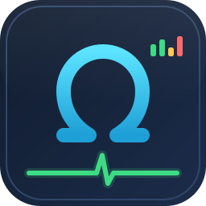

<p align="center"></p>

# SysVitals

[](https://github.com/Dhiva-Labs/SysVitals/actions/workflows/ci.yml)


One terminal tool that replaces four: **htop** (processes) + **netstat**
(connections) + **ss -tlnp** (open ports) + **smartctl** (SSD health).

**Documentation:** step-by-step guides at [learn.dhivalabs.com](https://learn.dhivalabs.com/apps/sysvitals/): [install](https://learn.dhivalabs.com/apps/sysvitals/install) · [beginner guide](https://learn.dhivalabs.com/apps/sysvitals/getting-started) · [troubleshooting](https://learn.dhivalabs.com/apps/sysvitals/faq). New to the topic? Try the [Networking and SSH](https://learn.dhivalabs.com/tracks/networking/) and [Linux and the terminal](https://learn.dhivalabs.com/tracks/terminal/) learning tracks.

Single-file Python, **zero dependencies** — stdlib only, Python 3.8+.

```
./sysvitals.py            # interactive TUI
sudo ./sysvitals.py       # + full NVMe SMART (wear %, TBW, power-on hours…)
./sysvitals.py --dump     # one plain-text snapshot (for scripts / ssh one-liners)
./sysvitals.py -i 1       # 1-second refresh
```

## Platforms

Linux only, on **x64 (x86-64) and arm64 (aarch64)**. It is a single Python
script with no compiled parts, so installation is the same on both: download
`sysvitals.py` and run it with any Python 3.8+.

- Everything is read from `/proc`, `/sys` and the NVMe admin ioctl; nothing is
  architecture-specific.
- The NVMe ioctl request is packed in the kernel's native byte order, and the
  test suite compiles a small C program against the system's
  `<linux/nvme_ioctl.h>` to check that the struct size, every field offset and
  the ioctl number match what SysVitals sends. That check runs on x64 and arm64
  in CI.
- CI runs the whole test suite (including the curses TUI in a pty and
  `--dump`) on Ubuntu 24.04 x64 and Ubuntu 24.04 arm64.
- CPU temperature is shown when the kernel exposes a recognised hwmon sensor
  (`k10temp`, `coretemp`, `zenpower`, `cpu_thermal`); machines without one, such
  as most virtual machines, simply omit that line.

## Packages

From the next release on, each GitHub release carries distribution packages
next to the script. They are architecture-independent (one file for x86-64
and arm64) and use the distribution's own Python 3:

| Distribution | File | Install |
|---|---|---|
| Fedora, RHEL/Rocky/Alma | `sysvitals-<version>-1.noarch.rpm` | `sudo dnf install ./sysvitals-<version>-1.noarch.rpm` |
| openSUSE Tumbleweed | the same `.rpm` | `sudo zypper install --allow-unsigned-rpm ./sysvitals-<version>-1.noarch.rpm` |
| Arch, Manjaro, EndeavourOS | `sysvitals-<version>-1-any.pkg.tar.zst` | `sudo pacman -U ./sysvitals-<version>-1-any.pkg.tar.zst` |
| AUR | `sysvitals-<version>-aur.tar.gz` (PKGBUILD + .SRCINFO) | `sysvitals` in the AUR once published |

The packages install the command as `sysvitals`. The `.rpm` is unsigned, hence
zypper's `--allow-unsigned-rpm`. `smartmontools` is a weak dependency (rpm
Recommends, Arch optdepends): it is only used for SATA drives. CI installs
each package on Fedora, openSUSE Tumbleweed and Arch Linux (x86-64), and on
Fedora and openSUSE arm64, and runs `--version`, `--dump` and the TUI through
every tab there; Arch Linux has no official arm64 image, so on arm64 the Arch
package gets a static check only. There is no AppImage or Flatpak: it is a
terminal tool.

## Tabs

| Tab | Shows |
|-----|-------|
| **1 Processes** | per-core CPU bars, mem/swap, CPU temp, sortable process table, kill (SIGTERM/SIGKILL) |
| **2 Network** | every TCP/UDP socket with state, user, and owning PID/program (netstat -tunp) |
| **3 Ports** | listening ports with service name; yellow = exposed on all interfaces |
| **4 Disks** | model, SSD/HDD, temp, live R/W throughput, NVMe SMART health, filesystem usage bars |

## Keys

`1‑4`/`F1‑F4`/`Tab` switch tabs · `↑↓ PgUp PgDn` move · `/` filter ·
`c m p n t` sort by cpu/mem/pid/name/time · `x`/`F9` kill · `q` quit

## SSD health sources

- NVMe: SMART/health log page read directly via the kernel admin ioctl
  (needs root; without root you still get temperature via hwmon).
  Shows: **life-remaining % bar**, wear used, spare capacity vs alarm
  threshold, projected remaining lifetime at the current write rate,
  decoded critical warnings (spare low / overtemp / reliability degraded /
  read-only / backup failed), lifecycle counters (power-on hours, power
  cycles, unsafe shutdowns, media errors, error-log entries), total data
  written/read, controller busy time, per-sensor temperatures, and time
  spent above the warning temperature.
- SATA: falls back to `smartctl -H -A` if smartmontools is installed —
  health verdict, life-left %, reallocated sectors, power-on hours,
  power cycles, temperature.
- All drives: model/serial/firmware from sysfs, temperature from
  `/sys/class/hwmon`, live throughput from `/proc/diskstats`.

## Sponsors

Dhiva Labs is an independent, self-funded lab. [Sponsorships](https://github.com/sponsors/Dhiva-Labs) help bring this project and the rest of Dhiva Labs to every platform, iPhone and Mac included.

[](https://github.com/sponsors/Dhiva-Labs)

Monthly sponsors at $10 and up are listed here:

<!-- sponsors -->
*Be the first: [sponsor Dhiva Labs](https://github.com/sponsors/Dhiva-Labs).*
<!-- sponsors -->
